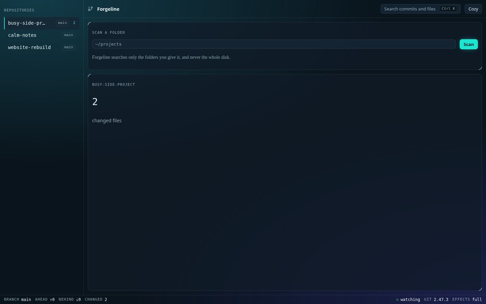
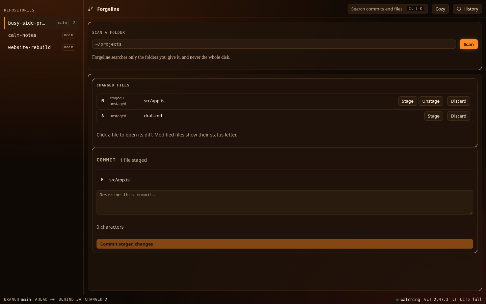
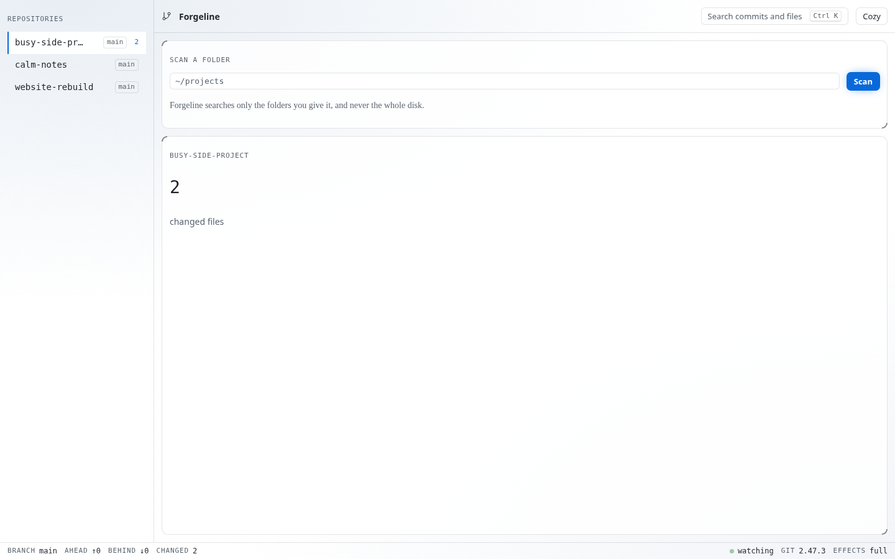
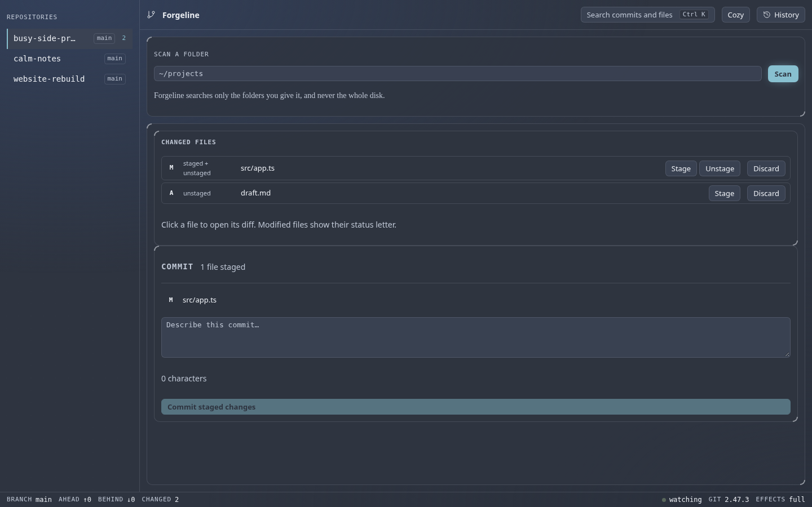
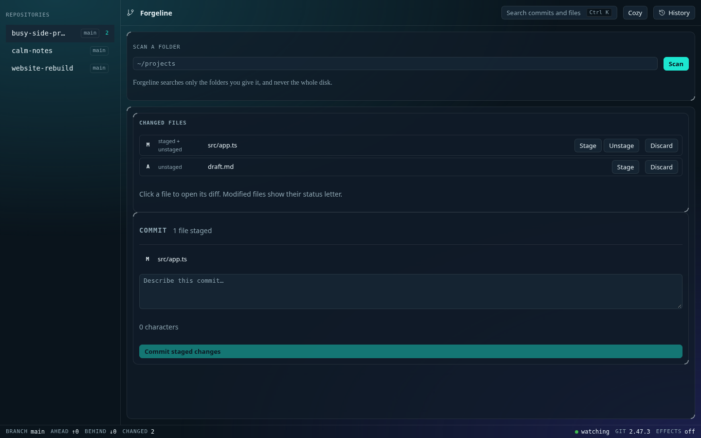

# Forgeline

A visual way to manage every git repository on your computer, built to look
like an instrument panel rather than a dashboard template.

Forgeline installs as an npm package, starts from your terminal, and opens a
local web interface on `127.0.0.1`. It is a visual layer over the real git
CLI — it never reimplements git, and every action can show you the exact
command it ran.

**Lagoon, the default**



**Cathode — amber CRT warmth**



**Paper — light and quiet**



## What it is for

Three groups, one interface:

- **People who are afraid of git.** Plain English first, with the raw git
  output behind a toggle when you want it.
- **Developers who want a faster visual layer.** Staging, diffs, branches and
  history without typing, and without losing the command line.
- **Non-developers who only need to save and share files.** A commit is one
  button and one sentence.

## Principles

These are not aspirations; they are constraints the code is held to.

- **Local first.** Everything except the actions that contact a remote
  (fetch, pull, push, publish a release) works with no internet. No account
  is needed unless a remote asks for one.
- **Wrap the git CLI.** The real git is always run, through one wrapper
  module, with argument arrays. Never a git library.
- **Never lose your work.** Uncommitted work is never discarded without a
  snapshot first. Undo is offered only where recovery is proven by tests;
  everything else says plainly that it cannot be undone, and why.
- **Explain, don't hide.** Every action can show the command behind it.
- **Looks hand-designed.** An instrument panel, not a dashboard template:
  layered surfaces, hairlines, registration ticks, and a heat ramp where
  recent work runs hot and old work runs cold. Every glow, gradient, and
  texture has to encode information or help orientation, or it is deleted.

## Themes

Appearance has two controls: a **family** (the palette) and a **mode** (dark
or light). A family that does not support a mode says so rather than offering
a broken one. Effects — motion, glow, blur, grain — have their own control,
defaulting from your system's reduced-motion setting, and can be turned off
entirely without losing any information.

| Family | Modes | |
| --- | --- | --- |
| Lagoon | Dark, Light | The default. Teal and cyan, glass panels |
| Cathode | Dark, Light | Amber CRT warmth: warm black, orange phosphor |
| Paper | Dark, Light | Neutral, GitHub-like, quiet blue accent |
| Mono | Dark, Light | Black and white, hairlines only |
| Dracula | Dark | |
| Nord | Dark | |
| Phosphor | Dark | Hidden, not in the picker |

Surfaces are Glass (translucent, ambient gradient, blur) or Solid (opaque and
flat). Effects Off forces Solid and removes all motion.





## Status

**Early. Milestones 1–3 are complete; Milestone 4 is in progress.** What works
today: the dashboard discovers repositories in folders you pick and shows live
branch, changed-file, and ahead/behind counts, pushed over a local stream as
files change. The commit flow works end to end — you can see what changed, stage
and unstage whole files or individual hunks, read both staged and unstaged
diffs, and commit with a sanity-check card that names every staged file before
anything is written. Every mutating action is recorded in an action journal
stored in your OS app-data folder, never inside a repository, and every action
can show the exact git command behind it.

What does not exist yet: the Undo timeline, snapshots, rescue mode, and
confirmation previews. Branches, history, conflicts, and remotes are not built
either. No control is drawn for a feature that is not built, so nothing is a
dead button.

The package has **not** been published to npm, and the name `forgeline` has
not been checked for availability. Do not treat it as installable yet.

See [docs/status.md](docs/status.md) for the milestone table, what is
verified, and the exact next step.

## How this was built

Forgeline is **vibecoded**: written by AI agents working from a detailed build
prompt, with a human directing the work and reviewing the output. It is not
maintained by a team, and it has not been audited by anyone who did not write
it.

That is worth knowing before you trust it with your repositories. The tests
are real and they run against real git repositories in throwaway temp
directories, but they were also written by the same agents that wrote the
code, so they share its blind spots. Treat this as a project to read and
learn from, not as infrastructure to depend on yet.

The build process is documented rather than hidden:

- [docs/spec.md](docs/spec.md) — the original build prompt the agents worked
  from. Source of truth for what gets built.
- [docs/decisions.md](docs/decisions.md) — every deviation from the spec, and
  why. The spec is never edited; changes are recorded here.
- [docs/architecture.md](docs/architecture.md) — module map, request flow,
  and the git execution rules.
- [docs/status.md](docs/status.md) — milestone table, verified flows, known
  limitations, and the next step.
- [docs/progress.md](docs/progress.md) — an append-only log of every slice,
  including the bugs found and the fixes.

If you want to see how an AI-built project handles the parts that usually go
wrong, `docs/progress.md` is the honest record: it keeps the mistakes.

## Requirements

- **Node.js** 22 or newer (24 recommended). Check: `node --version`.
- **git** 2.31 or newer. Forgeline checks on startup and refuses to start on
  older git. Check: `git --version`.
- Linux, macOS, or Windows. Only Linux has been exercised so far.

## Run it

From a checkout, after `npm ci`:

```
npm run build          # build the frontend and the server
node dist/cli.js       # start on an OS-assigned port and open the browser
node dist/cli.js 4700  # start on a specific port
node dist/cli.js --no-open
```

Forgeline prints a URL containing a one-time token and opens it in your
browser. That token is exchanged for an `HttpOnly`, `SameSite=Strict`
session cookie and removed from the address bar. It is single-use and expires
after five minutes; if it expires, press Enter in the terminal for a fresh
one.

### Ports

- No port given: bind port `0` and use whatever the OS assigns.
- A free port: use it.
- A port already in use: print `Port <n> is in use. Try <n+1>, or run forgeline with no port.` and exit non-zero. It never silently moves.
- An invalid port: print the error and the usage line, and exit non-zero.

The server binds `127.0.0.1` only. It is never reachable from your network.

## How scanning works

Forgeline never scans your whole disk. You pick folders — it suggests
`~/code`, `~/projects`, and `~/Documents` — and it searches those only, to a
bounded depth. It skips `node_modules` and hidden folders, does not descend
into a repository it has already found, and follows no symlinked directories.

Results refresh on their own. Forgeline watches each repository's
`.git/HEAD`, `.git/index`, and `.git/refs` and pushes changes to the open
page. On filesystems where native watching does not work, such as some
network drives, it falls back to polling every three seconds and says so in
the sidebar rather than going quietly stale.

Settings, notes, and caches live in your operating system's standard app-data
folder, never inside a repository.

## Security model

Because this is a local app driving real git, the surface is worth stating
plainly.

- **Bind:** `127.0.0.1` only.
- **Auth:** every `/api/*` route requires the session cookie. There is no
  password and no account.
- **Host and Origin:** a request with a foreign `Host` header is rejected
  with 403, which blocks DNS rebinding. Writes also require an allowed
  `Origin` and `Content-Type: application/json`.
- **Opaque IDs:** the browser never sends a filesystem path. It sends an ID
  the server issued, and a forged ID resolves to nothing.
- **Path handling:** repo-relative paths are checked lexically, then
  re-resolved and re-checked, so a symlink swapped in after registration
  cannot escape the repository.
- **Secrets:** tokens are never written to a URL that persists, a config
  file, or a log. Sign-in, when it lands, stores credentials in your OS
  keychain.

This is a guard against other websites and other local processes reaching
your repositories through the browser. It is not a sandbox: anyone who can
already write to the built files or to your repositories can already do what
this app does.

## Development

```
npm run dev:web     # Vite dev server for the frontend only
npm run build       # build frontend (dist/web) and server (dist/)
npm run verify      # typecheck + lint + lint:copy + unit tests + e2e tests
npm test            # unit tests only (vitest)
npm run test:e2e    # end-to-end tests (Playwright, 1440px and 800px)
```

`npm run verify` is the gate. Nothing is committed to `main` unless it is
green.

End-to-end tests need a browser once:

```
npx playwright install chromium
```

To refresh the screenshots above, with `npm run build` already done:

```
node scripts/capture-screenshots-design.mjs   # the themes shown above
node scripts/capture-screenshots-m2.mjs       # the earlier milestone-2 set
```

## Layout

```
src/cli.ts                    commander CLI: port rules, startup, clean shutdown
src/server/index.ts           Hono app: auth, routes, static serving, SSE
src/server/git/git.ts         the only module that runs git
src/server/git/diff.ts        changed-file records and unified-diff parsing
src/server/journal.ts         the action journal, written to app-data
src/server/snapshots.ts       private refs for pre-action recovery points
src/server/appdata.ts         resolves the OS app-data folder, never inside a repo
src/server/scan/              bounded repository discovery
src/server/live/              file watching with a polling fallback
src/server/queue.ts           per-repository single-writer queue
src/shared/types.ts           types shared by server and browser
src/web/src/theme/families.ts every colour, verified by scripts/check-contrast.mjs
src/web/src/theme/            ThemeProvider, tokens.css (structure only)
src/web/src/components/       RepoRail, StatusBar, CommandPalette, AppearancePanel
src/web/src/app/             App shell, API client, SSE-driven repo list
docs/                         spec, decisions, design, architecture, status, progress
```

## Documentation

The `docs/` folder is the working record of the build, listed above under
[How this was built](#how-this-was-built).

Two more, if you want them:

- [AGENTS.md](AGENTS.md) — the rules every session works under: reading
  order, commands, and the commit gate.
- [docs/setup.md](docs/setup.md) — what to install to run and test this on a
  new machine.

## Licence

Undecided. `package.json` currently declares `MIT` as a placeholder; no
`LICENSE` file has been chosen. This needs a decision before any publish.
